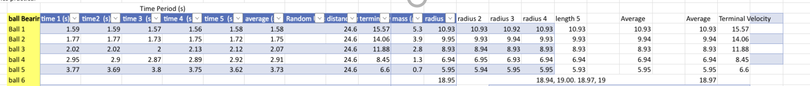

# AH Physics Navier stokes equation and FP1 applications
  - First order central + forward difference and second order central differential equations
  - use forward difference differential equations to calculate the spheres veloxity at different time intervals
  - using content from Al level further mathematics Further pure 1 Maths chapter 7, 8, 9
  - application 1 of Further prue content: first order differential equation: using forward differntial approximation to calcualte the speheres veloxity at succesive time intervals
  - application 2 of further pure content: second order differntial equation: express the model in terms of the spheres position and apply the central difference approximations for its first and second derevitives. 
- chapter 8: numerical calculus methdos : use find numerical solutions to first order differnetial equations using eulers method and midpoint method
- Extend eulers method to numerically find solutions to seecodn roder differential equations
- use simposons ruel to find an approximation to a given definite integral
- lienar vs no lienar differntiatl equations

